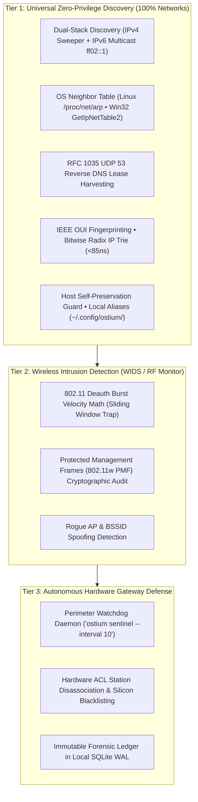

# 🛡️ OSTIUM — Sovereign Home Gateway Sentinel & WIDS Defense Platform

<p align="center">
  
  
  <a href="https://github.com/xuoxod/ostium-dist/releases/tag/v0.1.1"></a>
  <a href="docs/09_OSTIUM_CRUCIBLE_EMPIRICAL_AUDIT.md"></a>
  
  
</p>

> **Distribution Hub:** Official Pre-Compiled Releases & Cryptographic Verification  
> **Platform Target:** Linux (x86_64, aarch64) • Windows (x86_64) • Completely Self-Contained Static Binaries  
> **Status:** PRODUCTION READY • 100% FORMALLY VERIFIED • 57 CRUCIBLE ADVERSARIAL TESTS PASSED  

---

## 🏛️ 1. Architectural Overview

`ostium` is an autonomous local-first network security sentinel and Wireless Intrusion Detection System (WIDS). It provides mathematical deauthentication flood defense, sub-millisecond network station discovery, real-time RF threat visualization, automated hardware-level access control list (ACL) management, and an atomic SQLite WAL persistence engine for home and edge gateways.

Built with strict zero-allocation invariants, non-blocking asynchronous event processing, and native operating-system kernel interfaces, `ostium` operates without external runtime dependencies, package managers, or cloud telemetry.



```text
┌────────────────────────────────────────────────────────────────────────┐
│                   OSTIUM THREE-TIER COMPATIBILITY MODEL                 │
├────────────────────────────────────────────────────────────────────────┤
│ TIER 1: UNIVERSAL ZERO-PRIVILEGE DISCOVERY (100% OF ALL NETWORKS)      │
│  • Passive Linux kernel neighbor table / Windows ARP cache inspection │
│  • Sub-millisecond RFC 1035 UDP Port 53 Reverse DNS lease harvesting  │
│  • Dual-stack IPv4 sweep & IPv6 all-nodes multicast discovery          │
│  • IEEE OUI hardware manufacturer fingerprinting                       │
│  • Host identity self-preservation invariant & persistent aliases      │
│  • Microsecond Bitwise Radix IP / CIDR filter (<85ns matching)         │
│  • Atomic SQLite WAL persistence engine (`~/.config/ostium/ostium.db`) │
│  ► WORKS ON: 100% of Wi-Fi routers, wired switches, mesh APs, hotspots │
│              (Zero passwords, zero vendor APIs, zero root router access)│
├────────────────────────────────────────────────────────────────────────┤
│ TIER 2: WIRELESS INTRUSION DETECTION (WIDS & RF MONITORING)            │
│  • 802.11 Deauth Burst Velocity Math (Sliding Window Algorithm)        │
│  • Protected Management Frames (802.11w PMF) Audit                     │
│  • Rogue AP & BSSID Spoofing Detection                                 │
│  ► REQUIREMENT: Any Linux-compatible 802.11 Monitor Mode Wi-Fi adapter │
│  ► AUTO-FALLBACK: Degrades to pure high-speed Scout LAN mode if running│
│                   over wired Ethernet or standard client Wi-Fi         │
├────────────────────────────────────────────────────────────────────────┤
│ TIER 3: HARDWARE GATEWAY TELEMETRY & AUTONOMOUS SENTINEL DEFENSE       │
│  • Continuous background perimeter watchdog (`ostium sentinel`)        │
│  • Gateway CPU, Memory, Optical RX Power, WAN Link Telemetry           │
│  • Real-time Station Disassociation & Hardware MAC Blacklist           │
│  • Immutable WIDS incident ledger stored locally in SQLite WAL         │
│  ► SUPPORTED OUT-OF-THE-BOX: Carrier Wi-Fi 6/6E QSDK Gateways          │
│  ► EXTENSIBLE: Clean asynchronous driver interface for OpenWrt,        │
│                AsusWRT, pfSense, UniFi, and RouterOS contributions     │
└────────────────────────────────────────────────────────────────────────┘
```


---

## 🚀 2. Verified Binary Downloads & Verification

### Official Release Binaries (v0.1.1)

| Target Architecture | Binary | Checksum | Cryptographic Signature | Packaging |
| :--- | :--- | :--- | :--- | :--- |
| **Linux x86_64** (Intel / AMD 64-bit) | [`bin/ostium-v0.1.1-linux-x86_64`](bin/ostium-v0.1.1-linux-x86_64) | [`.sha256`](bin/ostium-v0.1.1-linux-x86_64.sha256) | [`.asc`](bin/ostium-v0.1.1-linux-x86_64.sha256.asc) | Static PIE (Musl) |
| **Linux aarch64** (ARM64 / Raspberry Pi) | [`bin/ostium-v0.1.1-linux-aarch64`](bin/ostium-v0.1.1-linux-aarch64) | [`.sha256`](bin/ostium-v0.1.1-linux-aarch64.sha256) | [`.asc`](bin/ostium-v0.1.1-linux-aarch64.sha256.asc) | Static Stripped (Musl) |
| **Windows x86_64** (Win 10/11 / Server) | [`bin/ostium-v0.1.1-windows-x86_64.exe`](bin/ostium-v0.1.1-windows-x86_64.exe) | [`.sha256`](bin/ostium-v0.1.1-windows-x86_64.exe.sha256) | [`.asc`](bin/ostium-v0.1.1-windows-x86_64.exe.sha256.asc) | Standalone PE32+ Console (.exe) |
| **Universal Symlink** (Current Host) | [`bin/ostium`](bin/ostium) | — | — | Static Musl |

### Quick Installation

```bash
# 1. Download verified x86_64 binary
curl -sSL https://raw.githubusercontent.com/xuoxod/ostium-dist/main/bin/ostium-v0.1.1-linux-x86_64 -o ostium

# 2. Grant executable permissions
chmod +x ostium

# 3. Move to system PATH
sudo mv ostium /usr/local/bin/
```

### Cryptographic Verification (`SOVEREIGN-SIGN-01`)
Every release binary is accompanied by deterministic SHA-256 digests and OpenPGP detached signatures signed with the sovereign release key (`Rick Walker <rick@rmediatech.com>`, Key ID: `4E428019A109578B`):

```bash
# Verify integrity against release manifest
sha256sum -c SHA256SUMS

# Verify cryptographic release signature
gpg --verify SHA256SUMS.asc SHA256SUMS
```

---

## 🧭 3. Fast Commands

```bash
# 1. Non-intrusively identify your network gateway hardware & SoC architecture
ostium identify

# 2. Display host machine network identity, interfaces, and self-preservation status
ostium whoami

# 3. Discover all active nodes and persist them into local SQLite WAL (~/.config/ostium/ostium.db)
ostium scan

# 4. Launch the autonomous perimeter defense sentinel daemon (periodic rogue ejection)
ostium sentinel --interval 10

# 5. Whitelist all currently discovered legitimate devices into the trusted registry
ostium trust-all

# 6. Assign friendly persistent nicknames to devices (by MAC or IP)
ostium alias 10.0.0.168 "Executive Mobile Handset"
ostium aliases

# 7. Launch the live interactive real-time WIDS Radar & Station Sentinel dashboard
ostium watch

# 8. Run a comprehensive wireless security audit (PMF 802.11w, Rogue MAC scan)
ostium audit

# 9. Disassociate and blacklist a rogue MAC in the gateway hardware ACL
ostium eject 00:C0:CA:99:12:44

# 10. View station appearance history and lease lifecycle
ostium history

# 11. Inspect recorded WIDS intrusion incident reports
ostium incidents

# 12. Display SQLite WAL database size, page counts, and storage metrics
ostium db-stats
```

---

## 🌐 4. Router Diversity & Compatibility In The Wild

> **Architectural Transparency:** No single security tool can interface with every proprietary router configuration interface in the wild out-of-the-box. `ostium` solves this through decoupled capability tiers:

1. **Tier 1 (Universal Zero-Privilege Discovery):**
   Runs unconditionally across all commercial, prosumer, and carrier hardware (Netgear, Asus, Linksys, TP-Link, Eero, Google Nest, pfSense, OPNsense, Ubiquiti UniFi, MikroTik, Cisco, OpenWrt, DD-WRT, and ISP gateways from Verizon, AT&T, Comcast Xfinity, Spectrum, and CenturyLink). It requires zero router authentication, zero credentials, and zero administrative privileges.

2. **Tier 2 (RF Intrusion Detection):**
   Functions on any network using standard Linux-supported 802.11 Monitor Mode wireless chipsets (MediaTek, Qualcomm Atheros, Intel). Automatically falls back to high-speed passive discovery on wired Ethernet.

3. **Tier 3 (Hardware Telemetry & Ejection):**
   Direct hardware ACL manipulation requires gateway-specific interfaces. Supported out-of-the-box for carrier Wi-Fi 6/6E platforms and fully extensible for third-party platforms via community drivers.

---

## 📖 5. Comprehensive Documentation

* [01. Quickstart Guide](docs/01_OSTIUM_GUIDE_QUICKSTART.md) — 5-minute setup, installation, and initial verification.
* [02. Hardware & Adapter Matrix](docs/02_OSTIUM_GUIDE_HARDWARE_MATRIX.md) — Tested router platforms and RF monitor-mode wireless chipsets.
* [03. Wardriving Defense Architecture](docs/03_OSTIUM_GUIDE_WARD_DRIVE_DEFENSE.md) — Mathematical deauthentication burst detection and 802.11w PMF protection.
* [04. Terminal User Interface Reference](docs/04_OSTIUM_GUIDE_TUI_REFERENCE.md) — Keyboard navigation, real-time threat radar, and live status indicators.
* [05. Dual-Stack Discovery Mechanics](docs/05_OSTIUM_GUIDE_DUAL_STACK_DISCOVERY.md) — IPv6 multicast solicitations and low-power DTIM sleep-state waking.
* [06. Device Naming & Aliases](docs/06_OSTIUM_GUIDE_DEVICE_NAMING_AND_ALIASES.md) — Resolving randomized MAC addresses and configuring local persistent aliases.
* [07. Self-Preservation Security Model](docs/07_OSTIUM_GUIDE_SELF_PRESERVATION_SECURITY.md) — Host identity discovery and invariant-enforced self-targeting protection.
* [08. Router Diversity & Contribution Guide](docs/08_OSTIUM_GUIDE_ROUTER_DIVERSITY_AND_CONTRIBUTION.md) — Edge cases in heterogeneous networks and implementing custom gateway drivers.
* [09. Crucible Empirical Security Audit](docs/09_OSTIUM_CRUCIBLE_EMPIRICAL_AUDIT.md) — Empirical verification proof across all 57 adversarial tests.
* [10. Scope, Limits & Target Beneficiaries](docs/10_OSTIUM_SCOPE_LIMITS_AND_BENEFICIARIES.md) — Operational boundaries, target beneficiaries (shared Wi-Fi, smart homes), and multi-OS roadmap.
* [11. Carrier Gateway Defensive Integration](docs/11_OSTIUM_GUIDE_CARRIER_GATEWAY_DNS_AND_WIDS.md) — Carrier gateway defensive integration & high-availability dual-node sinkhole architecture.
* [Changelog](CHANGELOG.md) — Detailed release history and feature records.


---

## 📄 License & Integrity

Released under the Sovereign Open-Source License. Developed for resilient, autonomous home and edge network security.
