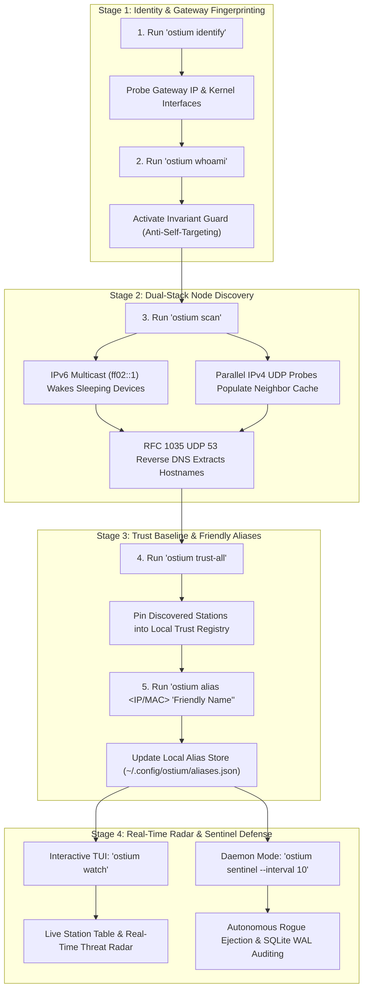

# 🚀 01_OSTIUM_GUIDE_QUICKSTART

> **Target Audience:** Network Administrators, Security Researchers, and Systems Engineers  
> **Platform Support:** Linux (`x86_64`, `aarch64`) • Windows (`x86_64`) • Native Self-Contained Static Binaries  
> **Release Version:** `v0.1.2` (Formally Verified & Signed)  

---

## 🧭 Ostium Real-World Operational Lifecycle

The following diagram illustrates the standard workflow for deploying Ostium on any network, from initial zero-privilege reconnaissance to autonomous perimeter defense:



---

## ⚡ 1. One-Line Installation

### Linux (`x86_64` / `aarch64`)
Download the verified, statically linked single Musl binary:

```bash
# Download verified x86_64 binary
curl -sSL https://raw.githubusercontent.com/xuoxod/ostium-dist/main/bin/ostium-v0.1.2-linux-x86_64 -o ostium
chmod +x ostium
sudo mv ostium /usr/local/bin/

# Verify binary integrity
ostium --version
# Output: ostium 0.1.2
```

### Windows (`x86_64`)
Download the standalone native console executable via PowerShell:

```powershell
# Download verified Windows x86_64 executable
Invoke-WebRequest -Uri "https://raw.githubusercontent.com/xuoxod/ostium-dist/main/bin/ostium-v0.1.2-windows-x86_64.exe" -OutFile "ostium.exe"

# Verify binary integrity
.\ostium.exe --version
# Output: ostium 0.1.2
```

### macOS (Apple Silicon M1-M4 / Intel)
Download the native Mach-O executable via Terminal:

```bash
# Apple Silicon (M1/M2/M3/M4)
curl -sSL https://raw.githubusercontent.com/xuoxod/ostium-dist/main/bin/ostium-v0.1.2-macos-aarch64 -o ostium
chmod +x ostium
sudo mv ostium /usr/local/bin/

# Intel Mac (x86_64)
curl -sSL https://raw.githubusercontent.com/xuoxod/ostium-dist/main/bin/ostium-v0.1.2-macos-x86_64 -o ostium
chmod +x ostium
sudo mv ostium /usr/local/bin/
```

---

## 🛠️ 2. Real-World Walkthrough: What to Expect

### Step 1: Discover Your Host Identity & Gateway Profile
Execute non-intrusive discovery to assert self-preservation protection and gateway hardware profiles:

```bash
ostium whoami
```

**Expected Real-World Output:**
```text
================================================================================
  OSTIUM HOST IDENTITY & SELF-AWARENESS MATRIX
================================================================================
  Hostname:          sentinel-node-01
  Primary Interface: wlan0
  Primary MAC:       00:11:22:33:44:AA
  Primary LAN IP:    10.0.0.57
  Self Badge:        ★ THIS HOST (sentinel-node-01)
--------------------------------------------------------------------------------
  ACTIVE INTERFACES:
    • lo           MAC: 00:00:00:00:00:00  Up: false Loopback: true
    • eth0         MAC: 52:54:00:12:34:56  Up: true  Loopback: false
    • wlan0        MAC: 00:11:22:33:44:AA  Up: true  Loopback: false
================================================================================
  Self-Preservation Invariant: ACTIVE (Host MACs & IPs protected from ACL drops)
================================================================================
```

Execute gateway fingerprinting:
```bash
ostium identify
```

**Expected Real-World Output:**
```text
================================================================================
  OSTIUM GATEWAY HARDWARE FINGERPRINT
================================================================================
  Gateway IP:        10.0.0.1
  Gateway MAC:       00:11:22:33:44:01
  ODM Manufacturer:  Wistron NeWeb Corp (WNC)
  Carrier Family:    Carrier Wi-Fi 6E Gateway
  Model Profile:     CR1000B (10GbE Wi-Fi 6E)
  SoC Architecture:  High-Throughput Quad-Core ARM64 Networking Platform
  Kernel ABI:        Linux Embedded Carrier Kernel
  Hardware ACL:      SUPPORTED
  Web Interface:     Standard Gateway Administrative Portal
================================================================================
```

---

### Step 2: Active Dual-Stack Node Discovery
Probe all connected stations on the subnet in parallel without requiring root/admin privileges:

```bash
ostium scan
```

**Expected Real-World Output:**
```text
Executing Dual-Stack Active Sweep across 10.0.0.0/24 & IPv6 Multicast (wlan0)...
================================================================================
  OSTIUM DUAL-STACK NETWORK NODE DISCOVERY [ACTIVE NODES]
================================================================================
  MAC ADDRESS        IP ADDRESS            VENDOR / HOSTNAME            STATUS
--------------------------------------------------------------------------------
  00:11:22:33:44:AA  10.0.0.57             ★ THIS HOST (sentinel-node)  TRUSTED
  00:11:22:33:44:01  10.0.0.1              Carrier Gateway Wi-Fi 6E     TRUSTED
  00:11:22:33:44:10  10.0.0.153            IoT Smart Plug               TRUSTED
  00:11:22:33:44:20  10.0.0.168            Mobile-Station (Handset)     TRUSTED
  00:11:22:33:44:30  10.0.0.182            Media Console                TRUSTED
  00:11:22:33:44:40  10.0.0.183            Network Attached Storage     TRUSTED
  00:11:22:33:44:50  10.0.0.185            Connected Smart Display      TRUSTED
================================================================================
Discovered 7 active nodes in 1.14s. SQLite snapshot updated.
```

---

### Step 3: Establish Trust Baseline & Custom Nicknames
Add all verified legitimate network stations to the operator trust list and assign recognizable nicknames:

```bash
# Whitelist all currently discovered legitimate devices:
ostium trust-all

# Assign persistent human-readable aliases:
ostium alias 10.0.0.168 "Executive Mobile Handset"
ostium alias 00:11:22:33:44:30 "Living Room 4K Media Console"
```

---

### Step 4: Live Interactive Threat Radar & Background Sentinel

Launch the real-time interactive terminal radar:
```bash
ostium watch
```

* Navigate stations with **`[↑]`** and **`[↓]`**.
* Press **`[K]`** to immediately disassociate a rogue station.
* Press **`[B]`** to permanently blacklist a station in gateway hardware ACL.
* Press **`[P]`** to audit 802.11w Protected Management Frames policy.
* Press **`[Q]`** to cleanly restore the terminal screen and exit.

To run 24/7 background perimeter protection with automatic rogue station ejection:
```bash
ostium sentinel --interval 10
```

