# 🛡️ 03_OSTIUM_GUIDE_WARD_DRIVE_DEFENSE

> **Target Audience:** Systems Engineers, Network Operators, Security Practitioners  
> **Topic:** Defending Edge & Home Networks Against RF Attackers and Handshake Harvesters  
> **Standard:** Universal Adversarial Invariant Pillar III (Adversarial Defense)  

---

## 🎯 1. Threat Profile: 802.11 Deauthentication Exploits

Wardriving and rogue RF reconnaissance typically target Wi-Fi Access Points (BSSIDs) to capture authentication materials:

1. **Active Deauthentication:** An attacker within physical RF range broadcasts spoofed Layer-2 **802.11 Deauthentication Management Frames** claiming to originate from the legitimate gateway.
2. **Forced Client Disassociation:** Target stations (laptops, mobile phones, IoT devices) are abruptly dropped from the wireless medium.
3. **Handshake Harvesting:** Upon automatic reconnection, the attacker captures the standard **4-Way EAPOL Handshake**.
4. **Offline Cryptanalysis:** The captured handshake is moved off-site for high-velocity dictionary or mask-based hash attacks.

---

## 🔬 2. Real-World Attack & Defense Mechanics

The sequence below illustrates how Ostium's dual-layer defense (Mathematical Sliding-Window Trap + 802.11w PMF Verification) neutralizes wardriving attempts:

```mermaid
sequenceDiagram
    autonumber
    actor Attacker as "RF Attacker (Wardriver)"
    participant Air as "802.11 Wireless Medium"
    participant Gateway as "Gateway AP (10.0.0.1)"
    participant Client as "Target Client (Handset / Laptop)"
    participant Ostium as "Ostium Sentinel (WIDS)"

    Note over Attacker,Air: Attack Phase: Deauthentication Flood (>100 frames/sec)
    Attacker->>Air: Spoofed 802.11 Deauth Frames (Forged AP MAC)
    Air->>Ostium: Raw Management Frames Ingested via Monitor Mode
    Air->>Client: Forged Disassociation Packets Received

    rect rgb(30, 40, 60)
    Note over Ostium: Mathematical Velocity Trap Evaluation
    Ostium->>Ostium: Sliding Window: >= 5 deauth frames in <= 250ms
    Ostium->>Ostium: Trap Triggered! WidsAlert(Severity::Critical)
    Ostium-->>Ostium: Emit Tactical Alert Tone & Append Incident to SQLite WAL
    end

    alt Gateway Enforces 802.11w PMF (Protected Management Frames)
        Note over Client: Cryptographic Verification (AES-128 CMAC / BIP)
        Client->>Client: Verify Frame Cryptographic Seal
        Client--xAir: Invalid Signature! Discarded at Radio PHY Layer
        Note over Client: Connection Maintained (Handshake Harvest Thwarted)
    else Legacy Unprotected Wi-Fi (No PMF)
        Client->>Air: Disconnected! Initiates Reassociation & 4-Way Handshake
        Attacker->>Attacker: Sniffs EAPOL 4-Way Handshake
        Note over Ostium: Autonomous Countermeasure
        Ostium->>Gateway: Issue Hardware ACL Ejection against Rogue MAC
        Gateway--xAttacker: Rogue Attacker MAC Blacklisted in Silicon
    end
```



---

## 🛡️ 3. Defense Mechanisms in Ostium

### A. Mathematical Velocity Trapping (`DeauthTrap`)
`ostium` executes a sliding-window rate evaluation across raw 802.11 management frames:
* Arrival of $\ge 5$ deauthentication or disassociation frames within a $250\text{ms}$ interval triggers immediate threshold breach detection.
* The system dispatches an audible alert tone, writes forensic metadata to the local security audit log, and flags the source MAC for defensive quarantine.

### B. Protocol-Level Immunity: 802.11w Protected Management Frames (PMF)
`ostium` audits whether the gateway enforces **802.11w (PMF)**:
* Under PMF, unicast and broadcast management frames are integrity-protected using **AES-128 CMAC (BIP - Broadcast Integrity Protocol)**.
* Spoofed management frames lacking valid cryptographic keys are discarded at the physical radio layer before reaching the operating system kernel.
* Attackers cannot force disconnections, neutralizing automated handshake-harvesting scripts.

### C. Autonomous Station Sentinel & ACL Isolation
If an unauthorized or rogue station attempts association, the sentinel classifies the station in $< 200\text{ms}$ and dispatches an immediate hardware ACL disassociation command, severing the rogue station's Layer-2 network access.

---

## 📊 4. Real-World Execution: What to Expect

### Auditing 802.11w PMF Wireless Security Status
Execute an audit to verify your router's Protected Management Frame posture:

```bash
ostium audit
```

**Expected Real-World Output:**
```text
================================================================================
  OSTIUM WIRELESS SECURITY & WIDS AUDIT REPORT
================================================================================
  Gateway IP:            10.0.0.1
  Gateway BSSID:         00:11:22:33:44:01
  SSID Broadcast:        Sovereign-Mesh-5G
  802.11w PMF Policy:    REQUIRED / ACTIVE (Management Frames Integrity Enforced)
  BIP Cipher Suite:      AES-128-CMAC (BIP-128)
  WIDS Trap Status:      ARMED (Sliding-Window Deauth Velocity Monitor)
  Active Stations:       7 Stations (All Verified in Whitelist)
  Rogue Stations:        0 Detected
  Hardware ACL Status:   ACTIVE (Synchronized with Silicon Engine)
================================================================================
[PASS] Gateway configuration is resilient against deauthentication handshake harvesting.
```

### Inspecting Captured WIDS Incidents
If a wardriving probe or deauthentication attempt is detected, inspect the SQLite WAL forensic audit trail:

```bash
ostium incidents
```

**Expected Real-World Output:**
```text
================================================================================
  OSTIUM WIDS INCIDENT FORENSIC AUDIT TRAIL [LOCAL SQLITE WAL]
================================================================================
  TIMESTAMP (UTC)       SEVERITY   ATTACK VECTOR        SOURCE MAC         ACTION TAKEN
--------------------------------------------------------------------------------
  2026-10-12 14:22:01   CRITICAL   Deauth Velocity Flood 00:C0:CA:99:12:44  ALERT EMITTED / BANNED
  2026-10-12 14:22:02   WARNING    Unsolicited ProbeReq  00:C0:CA:99:12:44  FLAGGED (SUSPECT_WARDRIVER)
================================================================================
2 incident records in local ledger (~/.config/ostium/ostium.db).
```

