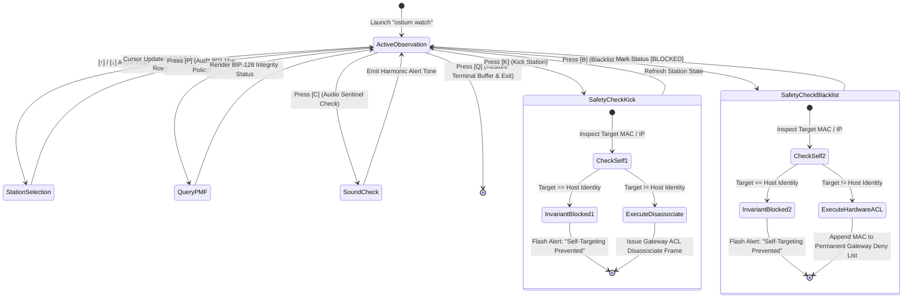

# 🖥️ 04_OSTIUM_GUIDE_TUI_REFERENCE

> **Target Audience:** Security Operators & Systems Engineers  
> **Topic:** Terminal User Interface Navigation & Interactive Threat Stream Controls  
> **Standard:** Sovereign Terminal UX Standard (Zero-Flicker RAII TUI Architecture)  

---

## 📺 1. Real-World Terminal Dashboard: What to Expect

When launching `ostium watch`, the application initializes an alternate terminal screen buffer and renders a high-density, real-time command dashboard:

```text
┌─────────────────────────────────────────────────────────────────────────────────────────────────┐
│ 🛡️ OSTIUM REAL-TIME STATION SENTINEL & WIDS RADAR v0.1.2                    Host: sentinel-node │
├─────────────────────────────────────────────────────────────────────────────────────────────────┤
│ GATEWAY: 10.0.0.1 (WNC CR1000B Wi-Fi 6E) │ IFACE: wlan0 │ MODE: DUAL-STACK WIDS │ PMF: 802.11w  │
├─────────────────────────────────────────────────────────────────────────────────────────────────┤
│  #  STATION IDENTIFIER / ALIAS     MAC ADDRESS        IP ADDRESS   VENDOR / OS      RSSI   STATUS │
│ ─────────────────────────────────────────────────────────────────────────────────────────────── │
│ >1. ★ THIS HOST (sentinel-node)    00:11:22:33:44:AA  10.0.0.57    Linux Kernel     -18dBm TRUSTED│
│  2. Gateway Access Point           00:11:22:33:44:01  10.0.0.1     Wistron NeWeb    -21dBm GATEWAY│
│  3. Executive Mobile Handset       00:11:22:33:44:20  10.0.0.168   Apple iOS        -46dBm TRUSTED│
│  4. Living Room 4K Media Console   00:11:22:33:44:30  10.0.0.182   Sony Interactive -52dBm TRUSTED│
│  5. Network Attached Storage       00:11:22:33:44:40  10.0.0.183   Synology NAS     -35dBm TRUSTED│
│  6. Kitchen Smart Display          00:11:22:33:44:50  10.0.0.185   Google Home      -61dBm TRUSTED│
│  7. Unauthorized Station Probe     00:C0:CA:99:12:44  10.0.0.244   Alfa Network     -79dBm ROGUE  │
├────────────────────────────────────────────────────────────────┬────────────────────────────────┤
│ 📡 WIRELESS THREAT RADAR & VELOCITY MONITOR                    │ 📋 REAL-TIME AUDIT STREAM      │
├────────────────────────────────────────────────────────────────┼────────────────────────────────┤
│ • 802.11 Deauth Velocity: 0 frames/sec (Threshold: 5/250ms)    │ 14:22:01 Discovered 10.0.0.244 │
│ • 802.11w Protected Management Frames: ACTIVE (AES-128 CMAC)   │ 14:22:02 Unrecognized MAC flag │
│ • Rogue Stations Detected: 1 (Row 7 selected)                  │ 14:22:05 Deauth trap armed OK  │
│ • Hardware ACL Guard: SYNCHRONIZED                             │ 14:22:10 Ready for operator cmd│
├────────────────────────────────────────────────────────────────┴────────────────────────────────┤
│ [↑/↓] Select Station │ [K] Kick │ [B] Blacklist │ [P] Audit PMF │ [C] Sound Check │ [Q] Quit    │
└─────────────────────────────────────────────────────────────────────────────────────────────────┘
```

---

## 🧭 2. Interactive Navigation & Safety State Machine

The state machine below illustrates interactive command handling and the automatic Self-Preservation Guard intercepting accidental self-drops:



---

## ⌨️ 3. Hotkey Navigation Matrix

When running the interactive dashboard (`ostium watch`), the terminal interface provides single-keypress command execution:

| Key | Action | Technical Description |
| :---: | :--- | :--- |
| **`[↑] / [↓]`** | **Station Cursor** | Navigate through the active station table. Host identity is pinned to row 1. |
| **`[K]`** | **Kick / Disassociate** | Dispatches an immediate hardware disassociation request to sever station connection. |
| **`[B]`** | **Blacklist MAC** | Appends the selected station MAC to the gateway's permanent hardware ACL deny list. |
| **`[P]`** | **Audit PMF** | Queries and displays active 802.11w Protected Management Frames policy status. |
| **`[C]`** | **Test Audio Alert** | Triggers an audio notification pulse to verify local sound hardware alerting. |
| **`[Q]`** | **Exit** | Restores terminal state, exits alternate screen buffer, and shuts down cleanly. |

---

## 📊 4. Station Status Classification

* **TRUSTED (Cyan / Green)**: Station MAC is registered in the operator's verified whitelist (`~/.config/ostium/whitelist.json`) or matches host identity.
* **GATEWAY (Blue)**: Default network gateway router providing upstream WAN connectivity.
* **ROGUE (Red)**: Unrecognized device actively communicating across the network.
* **SUSPECT_WARDRIVER (Magenta)**: Unrecognized station exhibiting weak RSSI ($\le -75\text{dBm}$) or matching offensive wireless chipset hardware signatures.
* **BLOCKED (Gray)**: Station currently restricted by gateway hardware ACL policy.

---

## 🛡️ 5. Host Invariant Guard

The local host running the sentinel is automatically discovered, highlighted with `★ THIS HOST`, and pinned to row 1. Attempting to disassociate (`[K]`) or blacklist (`[B]`) the host machine triggers an instant invariant block, preventing self-lockout:

```text
🛡️ Invariant Guard: MAC 00:11:22:33:44:AA belongs to this host; self-targeting prohibited.
```

