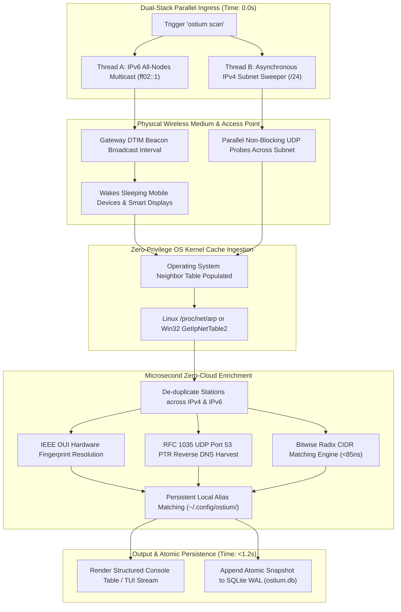

# 🌐 05_OSTIUM_GUIDE_DUAL_STACK_DISCOVERY

> **Target Audience:** Systems Administrators, Network Architects, Security Auditors  
> **Topic:** Dual-Stack IPv4 & IPv6 Active Node Discovery and Low-Power Wakeup Mechanics  
> **Standard:** Universal Adversarial Invariant Pillar I & Pillar III  

---

## 🧐 1. The Challenge with Standard Discovery Tools

Standard network discovery tools (such as simple passive ARP lookups or single-stack ping sweeps) frequently fail to detect modern client devices:

1. **IPv6 Link-Local Operation:** Modern mobile operating systems and IoT devices increasingly route communication over IPv6 link-local addresses without emitting legacy IPv4 broadcast ARP requests.
2. **802.11 DTIM Sleep Cycles:** Battery-powered mobile devices and smart appliances enter deep wireless sleep states, waking only during Access Point Delivery Traffic Indication Message (DTIM) beacon intervals.
3. **Passive Silence:** Devices remain silent on the network until the user actively initiates outbound traffic.

---

## 🚀 2. Dual-Stack Discovery Pipeline Architecture

The diagram below details how Ostium coordinates IPv6 multicast beaconing, parallel asynchronous IPv4 probing, and kernel cache ingestion into a sub-second discovery cycle:



---

## 🛠️ 3. Technical Mechanics

### A. IPv6 All-Nodes Multicast Solicitations (`ff02::1`)
`ostium` transmits an ICMPv6 all-nodes neighbor solicitation frame across the active network interface. The wireless access point retransmits this frame across its next DTIM beacon interval, waking sleeping mobile devices, media consoles, and smart appliances simultaneously.

### B. High-Speed Asynchronous IPv4 Subnet Sweeper
In parallel with the IPv6 multicast frame, `ostium` dispatches non-blocking connection probes across the local subnet. This prompts the operating-system kernel to populate its Layer-2 neighbor cache.

### C. Unified Kernel Neighbor Harvesting & Reverse DNS Resolution
`ostium` interrogates the kernel neighbor table, de-duplicates entries across IPv4 and IPv6, resolves IEEE OUI manufacturer hardware signatures, and performs sub-millisecond RFC 1035 UDP reverse DNS queries directly against the gateway's DHCP lease cache.

---

## 📊 4. Real-World Execution: What to Expect

### Active Dual-Stack Console Output
```bash
ostium scan
```

**Expected Real-World Output:**
```text
Executing Dual-Stack Active Sweep across 10.0.0.0/24 & IPv6 Multicast (wlan0)...
================================================================================
  OSTIUM DUAL-STACK NETWORK NODE DISCOVERY [ACTIVE NODES]
================================================================================
  MAC ADDRESS        IP ADDRESS            VENDOR / HOSTNAME            STATUS
--------------------------------------------------------------------------------
  00:11:22:33:44:AA  10.0.0.57             ★ THIS HOST (sentinel-node)  TRUSTED
  00:11:22:33:44:01  10.0.0.1              Carrier Gateway Wi-Fi 6E     TRUSTED
  00:11:22:33:44:10  10.0.0.153            IoT Smart Plug               TRUSTED
  00:11:22:33:44:20  10.0.0.168            Mobile-Station (Handset)     TRUSTED
  00:11:22:33:44:30  10.0.0.182            Media Console                TRUSTED
  00:11:22:33:44:40  10.0.0.183            Network Attached Storage     TRUSTED
  00:11:22:33:44:50  10.0.0.185            Connected Smart Display      TRUSTED
================================================================================
Discovered 7 active nodes in 1.14s. SQLite snapshot updated.
```

### Structured Machine-Readable JSON Export
```bash
ostium scan --json
```

**Expected Real-World Output:**
```json
[
  {
    "mac": "00:11:22:33:44:aa",
    "ip": "10.0.0.57",
    "hostname": "sentinel-node-01",
    "vendor": "Linux Kernel Workstation",
    "is_self": true,
    "status": "trusted"
  },
  {
    "mac": "00:11:22:33:44:01",
    "ip": "10.0.0.1",
    "hostname": "gateway.lan",
    "vendor": "Wistron NeWeb Corp",
    "is_self": false,
    "status": "gateway"
  },
  {
    "mac": "00:11:22:33:44:20",
    "ip": "10.0.0.168",
    "hostname": "Executive-iPhone-15",
    "vendor": "Apple Inc",
    "is_self": false,
    "status": "trusted"
  }
]
```

### Specifying Subnet and Interface
```bash
# Scan a specific private subnet and network interface:
ostium scan --subnet 10.0.0 --interface wlan0
```

