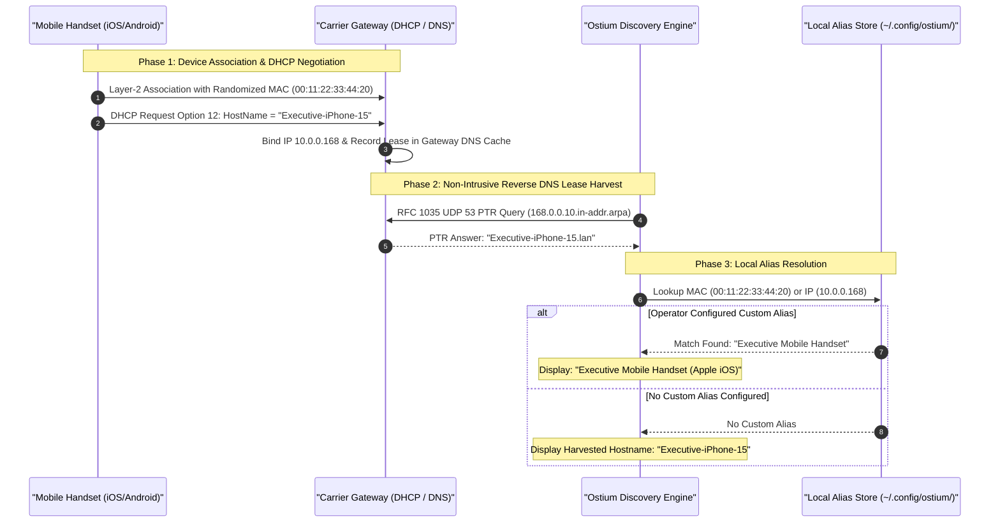

# 🏷️ 06_OSTIUM_GUIDE_DEVICE_NAMING_AND_ALIASES

> **Target Audience:** Systems Operators & Network Administrators  
> **Topic:** Device Hostname Discovery, Randomized MAC Resolution, and Local Aliases  
> **Standard:** Sovereign Data Custody (Zero-Cloud Local Alias Registry)  

---

## 📱 1. The "Private Wi-Fi" Address Challenge

Modern mobile operating systems (iOS 14+, Android 10+, Windows 11) enable **MAC Address Randomization** by default to prevent cross-network tracking. Instead of presenting authentic IEEE OUI manufacturer hardware identifiers, network analyzers encounter anonymous, locally administered MAC addresses:

```text
00:11:22:33:44:20  10.0.0.168  Locally Administered / Private MAC
```

Without hostname enrichment, operators cannot distinguish a company laptop from a visitor's mobile phone or a rogue intruder. `ostium` bridges this visibility gap through automated DHCP lease harvesting and a persistent local alias registry.

---

## 🔍 2. Hostname Resolution & Alias Pipeline

The diagram below details how Ostium correlates randomized MAC addresses with operating-system hostnames and user-configured aliases:



---

## 🔍 3. Sub-Millisecond Gateway Lease Harvesting

When a client device negotiates a DHCP lease with the gateway, it registers its operating-system friendly hostname.

`ostium` transmits non-intrusive RFC 1035 UDP reverse DNS PTR queries directly to the gateway (`<gateway-ip>:53`):
* `10.0.0.168` $\implies$ Resolves PTR $\implies$ Labels device as **`Executive-iPhone-15`**.
* `10.0.0.185` $\implies$ Resolves PTR $\implies$ Labels device as **`Kitchen-Smart-Display`**.
* `10.0.0.183` $\implies$ Resolves PTR $\implies$ Labels device as **`Backup-Vault-Storage`**.
* `10.0.0.153` $\implies$ Resolves PTR $\implies$ Labels device as **`LivingRoom-Smart-Plug`**.

---

## ✏️ 4. Custom Device Aliases: What to Expect

Operators can assign custom persistent identifiers to any station by IP address or hardware MAC:

```bash
# Assign a persistent friendly alias by IP:
ostium alias 10.0.0.168 "Executive Mobile Handset"

# Assign a persistent alias by MAC address (retains identity across DHCP renewals):
ostium alias 00:11:22:33:44:30 "Living Room 4K Media Console"
ostium alias 00:11:22:33:44:40 "Backup Vault Storage"
```

### Viewing the Configured Alias Registry
```bash
ostium aliases
```

**Expected Real-World Output:**
```text
================================================================================
  OSTIUM DEVICE ALIAS REGISTRY [CONFIGURED ENTRIES]
================================================================================
  TARGET IDENTIFIER        FRIENDLY ALIAS NICKNAME
--------------------------------------------------------------------------------
  10.0.0.168               -> Executive Mobile Handset
  00:11:22:33:44:30        -> Living Room 4K Media Console
  00:11:22:33:44:40        -> Backup Vault Storage
================================================================================
3 configured aliases loaded from ~/.config/ostium/aliases.json.
```

### Discovery Output with Aliases Applied
When running `ostium scan` or `ostium watch`, assigned aliases immediately override raw hardware strings:

```text
================================================================================
  OSTIUM DUAL-STACK NETWORK NODE DISCOVERY [ACTIVE NODES]
================================================================================
  MAC ADDRESS        IP ADDRESS   DEVICE ALIAS / IDENTIFIER         STATUS
--------------------------------------------------------------------------------
  00:11:22:33:44:AA  10.0.0.57    ★ THIS HOST (sentinel-node-01)    TRUSTED
  00:11:22:33:44:01  10.0.0.1     Carrier Gateway Wi-Fi 6E          TRUSTED
  00:11:22:33:44:20  10.0.0.168   Executive Mobile Handset          TRUSTED
  00:11:22:33:44:30  10.0.0.182   Living Room 4K Media Console      TRUSTED
  00:11:22:33:44:40  10.0.0.183   Backup Vault Storage              TRUSTED
================================================================================
```
Aliases are stored locally in `~/.config/ostium/aliases.json` under operator custody, with zero telemetry or cloud transmission.

